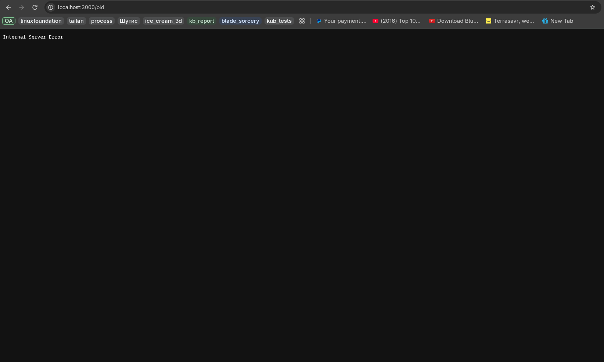

# BUG-01: "Хуучин хувилбар" холбоос ажиллахгүй байна

**Орчин:** Уншлагын жагсаалт v2.0, Mozilla Firefox 157.0, Fedora Linux, 2026-10-20  
**Урьдчилсан нөхцөл:** `node app.js`-ийг шинээр асаасан, анхны 3 номтой.

## Дахин гаргах алхам

1. Аппыг `node app.js` командаар шинээр асаана.
2. `http://localhost:3000` хаягийг browser-оор нээнэ.
3. Хуудасны доод хэсгийн **Хуучин хувилбар** холбоосыг дарна.

## Хүлээгдэж байсан

Specification-ийн дагуу бүх хуудас болон холбоос ажиллах ёстой. Хуучин хувилбарын холбоос зөв хуудас руу нээх ёстой.

## Бодит үр дүн

Холбоосыг дарахад хэвийн хуудасны оронд алдааны page харагдсан.

**Ноцтой байдал:** Major — хэрэглэгч navigation холбоосыг ашиглах боломжгүй байна.

**Хавсралт:**

**Олдсон аялал:** Supermodel
