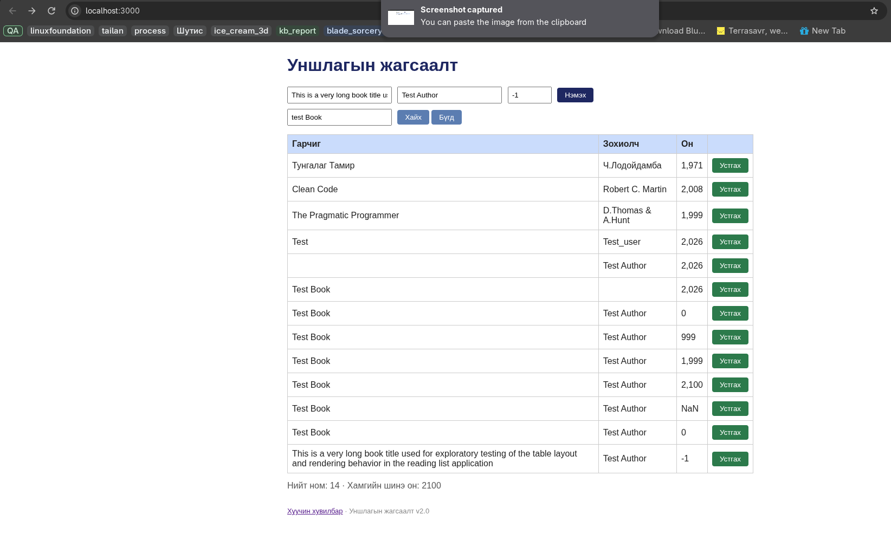
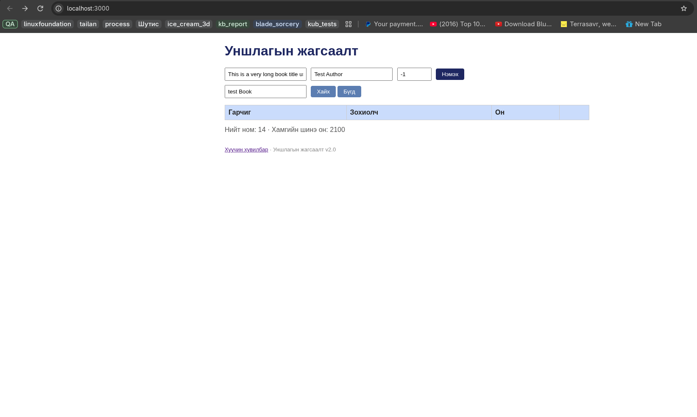

# BUG-02: Хайлт том болон жижиг үсгийг ялгаж байна

**Орчин:** Уншлагын жагсаалт v2.0, Mozilla Firefox 157.0, Fedora Linux, 2026-10-20  
**Урьдчилсан нөхцөл:** Аппыг шинээр асаасан бөгөөд анхны жагсаалтад `Clean Code` ном байна.

## Дахин гаргах алхам

1. Аппыг шинээр асаана.
2. `http://localhost:3000` хаягийг нээнэ.
3. Анхны жагсаалтад `Clean Code` байгаа эсэхийг шалгана.
4. Хайлтын талбарт `clean` гэж жижиг үсгээр бичнэ.
5. **Хайх** товчийг дарна.

## Хүлээгдэж байсан

Specification-ийн дагуу хайлт гарчиг болон зохиолчоос хайх ба том/жижиг үсэг ялгахгүй байх ёстой. `clean` query нь `Clean Code` номыг олох ёстой.

## Бодит үр дүн

`clean` гэж хайхад `Clean Code` ном үр дүнд харагдсангүй.

**Ноцтой байдал:** Major — хэрэглэгч casing өөрөөр оруулахад байгаа номыг хайлтаар олж чадахгүй байна.

**Хавсралт:**

Хайлтын өмнө:

Хайлтын дараа:

**Олдсон аялал:** Supermodel
