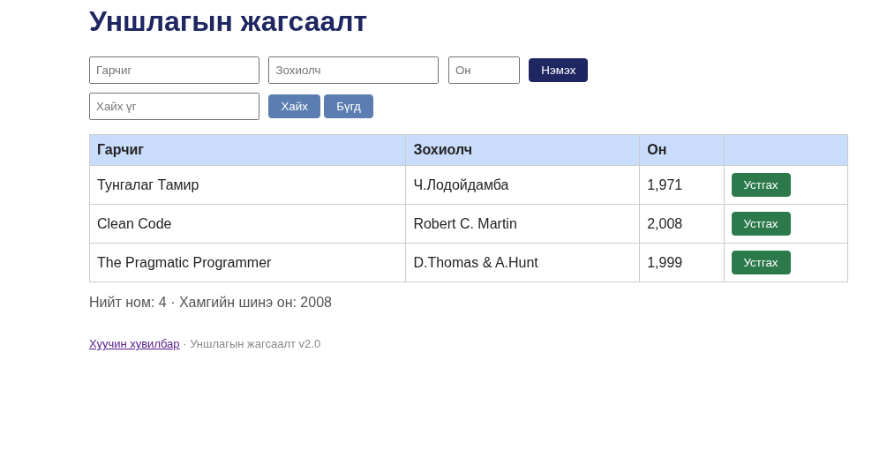

# BUG-04: Устгах товч улаан өнгөөр ялгагдахгүй байна

**Орчин:** Уншлагын жагсаалт v2.0, Mozilla Firefox 157.0, Fedora Linux, 2026-10-20  
**Урьдчилсан нөхцөл:** Аппыг шинээр асаасан.

## Дахин гаргах алхам

1. Аппыг шинээр асаана.
2. Нүүр хуудсыг нээнэ.
3. Хүснэгтийн **Устгах** товчийг ажиглана.

## Хүлээгдэж байсан

Specification-ийн дагуу аюултай үйлдлийн **Устгах** товч улаан өнгөтэй байх ёстой.

## Бодит үр дүн

Устгах товч улаан өнгөөр харагдахгүй байна.

**Ноцтой байдал:** Minor — ажиллагааг хаахгүй боловч аюултай үйлдлийн visual indication буруу байна.

**Хавсралт:**

**Олдсон аялал:** Supermodel
