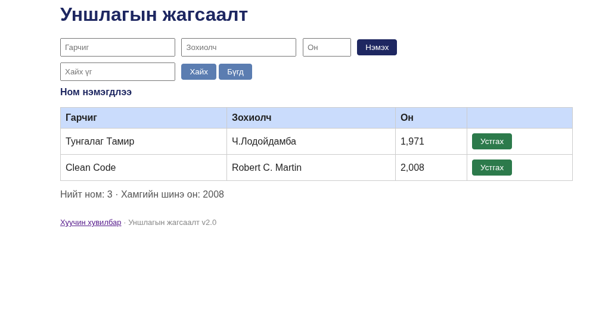

# BUG-06: Ном устгасны дараа буруу үйлдлийн мессеж харагдаж байна

**Орчин:** Уншлагын жагсаалт v2.0, Mozilla Firefox 157.0, Fedora Linux, 2026-10-20  
**Урьдчилсан нөхцөл:** Аппыг шинээр асаасан, анхны 3 номтой.

## Дахин гаргах алхам

1. Аппыг шинээр асаана.
2. Нүүр хуудсыг нээнэ.
3. Аль нэг номын **Устгах** товчийг дарна.
4. Үйлдлийн дараах мессежийг ажиглана.

## Хүлээгдэж байсан

Specification-ийн дагуу үйлдлийн дараах мессеж тухайн үйлдэлдээ тохирсон байх ёстой. Ном устгасныг хэрэглэгчид зөв мэдээлэх ёстой.

## Бодит үр дүн

Ном устгасны дараа устгах үйлдэлтэй тохироогүй, ном нэмсэн мэт утгатай мессеж харагдсан.

**Ноцтой байдал:** Minor — устгах ажиллагаа хийгдсэн боловч хэрэглэгчид буруу feedback өгч байна.

**Хавсралт:**

**Олдсон аялал:** Supermodel
