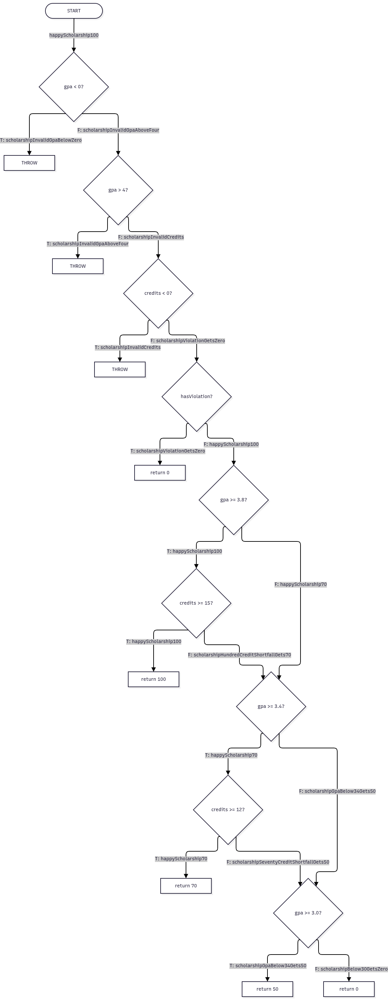

# Лаборатори №9 — Код хамралт / JaCoCo

## Оюутны мэдээлэл

- **Нэр:** Батбилэг Тэмүүлэн
- **Оюутны код:** B232270042
- **Хичээл:** F.CSA313 — Программ хангамжийн чанарын баталгаа ба тест

---

## Орчин

### `java -version`

```text
openjdk version "21.0.12.1" 2026-08-18
OpenJDK Runtime Environment (Red_Hat-21.0.12.1.1-1) (build 21.0.12.1+1)
OpenJDK 64-Bit Server VM (Red_Hat-21.0.12.1.1-1) (build 21.0.12.1+1, mixed mode, sharing)
```

### `mvn -version`

```text
Apache Maven 3.9.11 (Red Hat 3.9.11-5)
Maven home: /usr/share/maven
Java version: 21.0.8, vendor: JetBrains s.r.o., runtime: /home/asaku/android-studio/jbr
Default locale: en_US, platform encoding: UTF-8
OS name: "linux", version: "7.2.15-100.fc43.x86_64", arch: "amd64", family: "unix"
```

---

## Зорилго

Энэ лабораторийн ажлаар `ScholarshipCalculator` классын тестийн хамралтыг JaCoCo ашиглан хэмжиж, coverage тайлангаас дутуу салаа болон мөрүүдийг илрүүлж тестүүд нэмсэн.

Мөн Line болон Branch coverage 100% болсон ч specification-ийн зааг утгын алдаа тестэд баригдалгүй үлдэж болохыг boundary-value тестээр шалгасан.

Лабораторийн гол зорилго нь coverage өндөр байх нь тестийн чанарт чухал боловч програм логикийн хувьд бүрэн зөв гэдгийг дангаараа батлах боломжгүйг практик байдлаар харуулах байсан.

---

# Хэсэг A — Happy path тестүүд ба эхний coverage

Эхний шатанд зөвхөн хэвийн ажиллагааны замуудыг шалгах 5 happy-path тест ашигласан.

Шалгасан жишээнүүд:

- `letterGrade(95) == "A"`
- `letterGrade(85) == "B"`
- `gpa([95, 85]) == 3.5`
- `scholarship(3.9, 16, false) == 100`
- `scholarship(3.5, 12, false) == 70`

Тестийн үр дүн:

```text
Tests run: 5, Failures: 0, Errors: 0, Skipped: 0
BUILD SUCCESS
```

`results/jacoco-A.csv`-ийн coverage үр дүн:

| Үзүүлэлт | Missed | Covered | Coverage |
|---|---:|---:|---:|
| Branch | 21 | 20 | 48.8% |
| Line | 10 | 15 | 60.0% |

Эхний happy-path тестүүд үндсэн зөв ажиллагааны замуудыг хамарсан боловч validation, exception болон бусад error path-ууд огт ажиллаагүй.

JaCoCo HTML тайлан дээр огт хүрээгүй мөрүүд улаан, зөвхөн нэг чиглэлээр ажилласан decision-ууд шар ромбо хэлбэрээр partial coverage-тай харагдсан.

Энэ нь зөвхөн хэвийн оролтыг шалгах тестүүд програмын бүтцийн бүх салааг хангалттай хамарч чадахгүй байгааг харуулсан.

### Evidence

- `results/mvn-verify-A.txt`
- `results/jacoco-A.csv`

---

# Хэсэг B — CFG ба 100% Branch coverage

Part A-ийн JaCoCo тайланг ашиглан хүрээгүй болон хагас хамрагдсан control-flow замуудыг тодорхойлсон.

Дараа нь `scholarship()` функцын Control Flow Graph буюу CFG-г зурж `cfg.png` файлд хадгалсан.

CFG-ийн decision бүрийн T/F ирмэг дээр тухайн ирмэгийг бодитоор дайрдаг тестийн методын нэрийг тэмдэглэсэн. Жишээлбэл `gpa < 0`-ийн true ирмэгийг `scholarshipInvalidGpaBelowZero`, `credits >= 15`-ийн false ирмэгийг `scholarshipHundredCreditShortfallGets70` тест дайрна.



Coverage тайлангийн дутуу салаануудаас шалтгаалан дараах төрлийн тестүүдийг нэмсэн:

- `letterGrade()`-ийн invalid score validation
- `letterGrade()`-ийн C, D, F замууд
- `gpa()`-ийн null болон empty validation
- `gpa()`-ийн `switch` доторх бүх grade branch
- `scholarship()`-ийн invalid GPA болон credits
- `hasViolation == true`
- GPA өндөр боловч credit хүрэхгүй зам
- GPA 3.4–3.79 зам
- GPA 3.0–3.39 зам
- GPA 3.0-аас доош зам

Part B үед:

```text
Tests run: 21, Failures: 0, Errors: 0, Skipped: 0
BUILD SUCCESS
```

`results/jacoco-B.csv`:

```text
BRANCH_MISSED=0
BRANCH_COVERED=41
LINE_MISSED=0
LINE_COVERED=25
`r`

Ингэснээр `ScholarshipCalculator` классын:

- **Branch coverage = 100%**
- **Line coverage = 100%**

болсон.

Part B дээр нийт 41 branch бүгд хамрагдаж, 25 мөр бүгд ажилласан.

### Evidence

- `results/mvn-verify-B.txt`
- `results/jacoco-B.csv`
- `cfg.png`

---

# Хэсэг C — Давталтын заагийн тест

`gpa()` функц дотор массивын элементүүдээр давталт хийдэг тул 0 / 1 / 2+ дүрмийн дагуу давталтын заагийн тестүүдийг тусад нь нэмсэн.

## 0 удаа

Хоосон массив:

```java
gpa(new double[]{})
```

мөн:

```java
gpa(null)
```

оролтуудад `IllegalArgumentException` шидэхийг `assertThrows` ашиглан шалгасан.

## 1 удаа

```java
gpa(new double[]{95}) == 4.0
```

гэж шалгасан.

## 2+ удаа

```java
gpa(new double[]{95, 85, 75, 65}) == 2.5
```

гэж шалгасан.

Part C-ийн дараа:

```text
Tests run: 24, Failures: 0, Errors: 0, Skipped: 0
BUILD SUCCESS
```

Эдгээр тестүүд coverage-ийн хувийг нэмэхгүй байж болох ч давталтын boundary behavior зөв эсэхийг тусад нь баталгаажуулдаг.

Structural coverage аль хэдийн 100% болсон байсан ч массивын хэмжээ 0, 1 болон олон элементтэй байх үед функц зөв ажиллаж байна гэдгийг coverage percentage өөрөө баталж чадахгүй.

Part C commit:

```text
8343b02 add Lab09 Part C loop boundary tests
```

---

# Хэсэг D — 100% coverage байсан ч амьд үлдсэн алдаа

Part B-ийн дараа Line болон Branch coverage хоёул 100% болсон байсан.

Гэхдээ specification-д:

```text
60–69.99 = D
```

гэж заасан тул зааг утгуудыг тусгайлан шалгах boundary-value тест нэмсэн.

Шалгасан утгууд:

```text
60
59.99
69.99
0
100
89.99
90
```

Эдгээрийг `@ParameterizedTest` болон `@CsvSource` ашиглан нэг parameterized test-д оруулсан.

Тестийн нэр:

```text
letterGradeBoundaryValues
```

## Илэрсэн алдаа

Boundary-value тестийг ажиллуулахад яг `60` оноон дээр тест унасан.

```text
ScholarshipCalculatorTest.letterGradeBoundaryValues(double, String)[1]
expected: <D> but was: <F>
```

Failing run:

```text
Tests run: 31, Failures: 1, Errors: 0, Skipped: 0
BUILD FAILURE
```

Бүтэн гаралт:

```text
results/mvn-test-D-fail.txt
```

файлд хадгалагдсан.

Boundary test-ийг алдаа засахаас өмнө тусдаа commit хийсэн:

```text
c617d7b add Lab09 boundary tests exposing score 60 defect
```

---

## Алдааны шалтгаан

Анхны кодонд:

```java
if (score > 60) return "D";
```

гэж байсан.

Ийм нөхцөлд:

```text
score = 60
```

үед `score > 60` false болох тул `"F"` буцааж байсан.

Гэтэл specification-ийн дагуу 60 оноо өөрөө `"D"` байх ёстой.

Тиймээс:

```java
if (score > 60) return "D";
```

гэсэн нөхцөлийг:

```java
if (score >= 60) return "D";
```

болгон зассан.

Засварыг тусдаа commit хийсэн:

```text
1563b04 fix Lab09 letterGrade boundary: 60 must be D
```

---

## Эцсийн үр дүн

Засварын дараа бүх тест дахин амжилттай ажилласан.

```text
Tests run: 31, Failures: 0, Errors: 0, Skipped: 0
BUILD SUCCESS
```

Эцсийн `results/jacoco-final.csv`:

```text
BRANCH_MISSED=0
BRANCH_COVERED=41
LINE_MISSED=0
LINE_COVERED=25
```

Ингэснээр эцсийн байдлаар:

- Branch coverage = **100%**
- Line coverage = **100%**
- Tests run = **31**
- Failures = **0**
- Errors = **0**

болсон.

---

# Гол дүгнэлт

Branch coverage 100% гэдэг нь боломжит control-flow салаа бүр дор хаяж нэг удаа ажилласан гэсэн үг боловч тухайн нөхцөлийн бүх утга зөв боловсруулагдаж байна гэсэн баталгаа биш.

`score > 60` болон `score >= 60` хоёр нөхцөл нь JaCoCo-ийн хувьд адилхан true/false салаанууд үүсгэдэг.

Өмнөх тестүүд 65 зэрэг утгаар true салаа, 55 зэрэг утгаар false салааг аль хэдийн ажиллуулсан тул Branch coverage 100% хүрсэн байсан.

Гэхдээ яг `60` гэсэн зааг утгыг шалгаагүй учраас specification-ийн алдаа 100% coverage-ийн цаана үлдсэн.

Boundary-value тест нэмснээр энэ semantic ялгаа шууд илэрсэн.

Иймээс coverage нь тест дутуу control-flow хэсгийг олоход маш хэрэгтэй боловч програм зөв гэдгийг дангаараа нотлох хангалттай хэмжүүр биш.

---


# Evidence файлууд

Лабораторийн үр дүнгийн нотолгоонууд:

```text
results/
├── mvn-verify-A.txt
├── jacoco-A.csv
├── mvn-verify-B.txt
├── jacoco-B.csv
├── mvn-test-D-fail.txt
├── mvn-verify-final.txt
└── jacoco-final.csv
```

Мөн:

```text
cfg.png
```

файлд `scholarship()` функцын CFG хадгалагдсан.

---

# AI ашиглалт

AI туслахыг лабораторийн алхмуудыг дарааллуулах, shell командууд бэлтгэх, тестийн skeleton боловсруулах, coverage шалгах командууд гаргах болон README-ийн бүтцийг эмхлэхэд ашигласан.

---

# Тэмдэглэл

Энэхүү лабораторийн ажлыг хугацаанаас хоцорч гүйцэтгэсэн боловч дараагийн лабораториудын суурь ойлголтод шаардлагатай гэж үзсэн тул бүрэн хийж дуусгалаа.

Хоцорсон явдалд хүлцэл өчье — ядаж “хоцорсон ч хийсэн” ангилалд үлдэхийг зорив. :)
