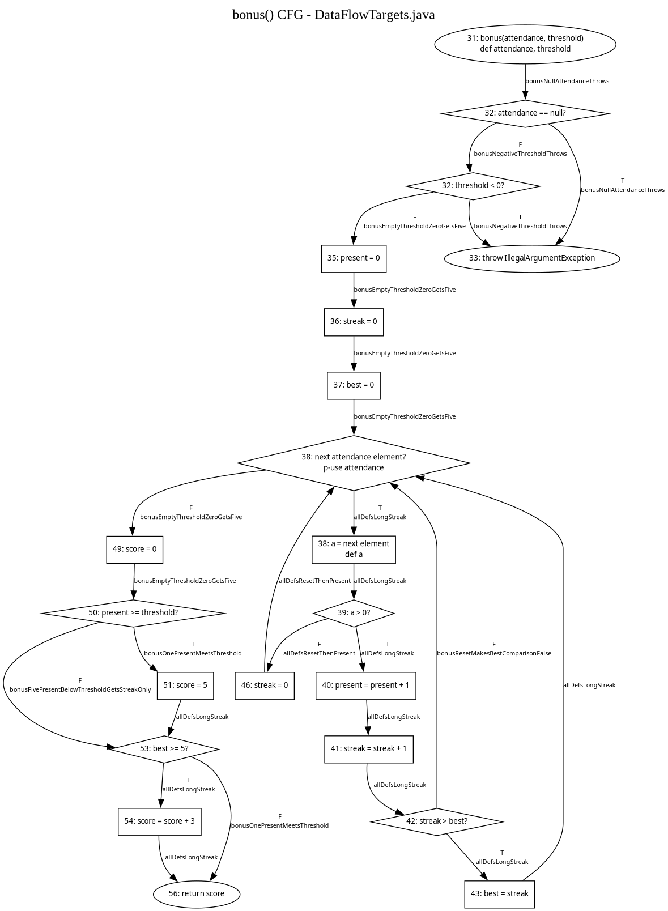

# Лаборатори №10 — Өгөгдлийн урсгалын тест / Definition-Use хосууд

## Оюутны мэдээлэл

- **Нэр:** Батбилэг Тэмүүлэн
- **Оюутны код:** B232270042
- **Хичээл:** F.CSA313 — Программ хангамжийн чанарын баталгаа ба тест

---

## Орчин

### `java -version`

```text
openjdk version "21.0.12.1" 2026-08-18
OpenJDK Runtime Environment (Red_Hat-21.0.12.1.1-1) (build 21.0.12.1+1)
OpenJDK 64-Bit Server VM (Red_Hat-21.0.12.1.1-1) (build 21.0.12.1+1, mixed mode, sharing)
```

### `mvn -version`

```text
Apache Maven 3.9.11 (Red Hat 3.9.11-5)
Maven home: /usr/share/maven
Java version: 21.0.8, vendor: JetBrains s.r.o., runtime: /home/asaku/android-studio/jbr
Default locale: en_US, platform encoding: UTF-8
OS name: "linux", version: "7.2.15-100.fc43.x86_64", arch: "amd64", family: "unix"
```

---

# Зорилго

Энэ лабораторийн ажлаар `DataFlowTargets` классын `gcd()` болон `bonus()` функцүүд дээр өгөгдлийн урсгалын анализ хийсэн.

Хувьсагч бүрийн definition болон c-use / p-use цэгүүдийг тодорхойлж, def-clear замтай DU хосуудыг гаргасан. Эхлээд all-defs, дараа нь all-DU-pairs хамралтыг өгөх JUnit тестүүд бичсэн.

Мөн кодод урсгалын гурван төрлийн алдаа түр тарьж, DU-д чиглэсэн тестүүд эдгээр алдааг хэр сайн илрүүлж байгааг шалгасан.

---

# Хэсэг A — `gcd()` DU анализ

`gcd()` функцын ашигласан мөрүүд:

```text
13  gcd(int x, int y)
15  while (y != 0)
16  tmp = x % y
17  x = y
18  y = tmp
20  return x
```

## Тестүүд

| ID | Метод | Зорилго |
|---|---|---|
| G1 | `gcdZeroSecondOperand` | `gcd(7,0)` — loop-д орохгүй зам |
| G2 | `gcdMultipleIterations` | `gcd(12,8)` — олон давталттай зам |

`gcd(7,0)` нь initial `x` definition-ээс шууд `return x` хүрэх `x: 13 → 20` хосыг хамруулдаг.

`gcd(12,8)` хоёр удаа давталт хийдэг тул loop дотор дахин тодорхойлогдсон `x`, `y`, `tmp`-ийн DU хосуудыг хамруулдаг.

## `gcd()`-ийн бүрэн DU хүснэгт

| Хувьсагч | Def мөр | Use мөр | Төрөл | Def-clear зам | Тест | Хамрагдсан |
|---|---:|---:|---|---|---|---|
| x | 13 | 16 | c-use | 13 → 15(T) → 16 | G2 | Тийм |
| x | 13 | 20 | c-use | 13 → 15(F) → 20 | G1 | Тийм |
| x | 17 | 16 | c-use | 17 → 18 → 15(T) → 16 | G2 | Тийм |
| x | 17 | 20 | c-use | 17 → 18 → 15(F) → 20 | G2 | Тийм |
| y | 13 | 15(T) | p-use | 13 → 15(T) | G2 | Тийм |
| y | 13 | 15(F) | p-use | 13 → 15(F) | G1 | Тийм |
| y | 13 | 16 | c-use | 13 → 15(T) → 16 | G2 | Тийм |
| y | 13 | 17 | c-use | 13 → 15(T) → 16 → 17 | G2 | Тийм |
| y | 18 | 15(T) | p-use | 18 → 15(T) | G2 | Тийм |
| y | 18 | 15(F) | p-use | 18 → 15(F) | G2 | Тийм |
| y | 18 | 16 | c-use | 18 → 15(T) → 16 | G2 | Тийм |
| y | 18 | 17 | c-use | 18 → 15(T) → 16 → 17 | G2 | Тийм |
| tmp | 16 | 18 | c-use | 16 → 17 → 18 | G2 | Тийм |

Ингэснээр `x`, `y`, `tmp` гурван хувьсагчийн бүх боломжит def-clear DU хос хамрагдсан.

---

# Хэсэг B — `bonus()` бүрэн анализ

## B1 — CFG

`bonus()` функцын CFG-г `cfg-bonus.png` файлд хадгалсан.



CFG дээр зангилаа бүрт `DataFlowTargets.java` файлын бодит мөрийн дугаар бичсэн.

Мөн CFG-ийн **ирмэг бүр дээр тухайн ирмэгийг бодитоор дайрдаг тестийн методын нэр** бичигдсэн. For-each давталтын нөхцөл болон дараагийн элементийг `a` хувьсагчид оноох definition-ийг тусдаа зангилаагаар үзүүлсэн.

---

## B2 — Definition / Use жагсаалт

| Мөр | Үйлдэл | Def | Use |
|---:|---|---|---|
| 31 | `bonus(attendance, threshold)` | attendance, threshold | — |
| 32 | input validation | — | attendance p-use, threshold p-use |
| 35 | `present = 0` | present | — |
| 36 | `streak = 0` | streak | — |
| 37 | `best = 0` | best | — |
| 38 | for-each | a | attendance p-use |
| 39 | `a > 0` | — | a p-use |
| 40 | `present = present + 1` | present | present c-use |
| 41 | `streak = streak + 1` | streak | streak c-use |
| 42 | `streak > best` | — | streak p-use, best p-use |
| 43 | `best = streak` | best | streak c-use |
| 46 | `streak = 0` | streak | — |
| 49 | `score = 0` | score | — |
| 50 | `present >= threshold` | — | present p-use, threshold p-use |
| 51 | `score = 5` | score | — |
| 53 | `best >= 5` | — | best p-use |
| 54 | `score = score + 3` | score | score c-use |
| 56 | `return score` | — | score c-use |

---

## Тестийн ID

| ID | Метод |
|---|---|
| B1 | `allDefsLongStreak` |
| B2 | `allDefsResetThenPresent` |
| B3 | `bonusNullAttendanceThrows` |
| B4 | `bonusNegativeThresholdThrows` |
| B5 | `bonusEmptyThresholdZeroGetsFive` |
| B6 | `bonusEmptyThresholdOneGetsZero` |
| B7 | `bonusOnePresentMeetsThreshold` |
| B8 | `bonusResetMakesBestComparisonFalse` |
| B9 | `bonusFivePresentBelowThresholdGetsStreakOnly` |
| B10 | `bonusSeparatedAttendanceDoesNotEarnFiveDayStreak` |

B10 нь үндсэн all-DU-pairs хамралтаас хойш M2 mutation-ийг унагахын тулд нэмсэн тест.

---

## B3 — `bonus()` DU хүснэгт

### `attendance`

| Def | Use | Төрөл | Def-clear зам | Тест |
|---:|---:|---|---|---|
| 31 | 32(T) | p-use | 31 → 32(T) | B3 |
| 31 | 32(F) | p-use | 31 → 32(F) | B4 |
| 31 | 38(T) | p-use | 31 → 32(F) → 35 → 36 → 37 → 38(T) | B1 |
| 31 | 38(F) | p-use | validation → 38(F) | B5 |

### `threshold`

| Def | Use | Төрөл | Def-clear зам | Тест |
|---:|---:|---|---|---|
| 31 | 32(T) | p-use | attendance non-null → threshold < 0 | B4 |
| 31 | 32(F) | p-use | attendance non-null → threshold >= 0 | B5 |
| 31 | 50(T) | p-use | validation → loop → 49 → 50(T) | B1 / B5 |
| 31 | 50(F) | p-use | validation → loop → 49 → 50(F) | B6 / B9 |

### `a`

| Def | Use | Төрөл | Def-clear зам | Тест |
|---:|---:|---|---|---|
| 38 | 39(T) | p-use | 38(def a) → 39(T) | B1 |
| 38 | 39(F) | p-use | 38(def a) → 39(F) | B2 |

### `present`

| Def | Use | Төрөл | Def-clear зам | Тест |
|---:|---:|---|---|---|
| 35 | 40 | c-use | 35 → first positive attendance → 40 | B1 |
| 35 | 50(T) | p-use | no present day → 50(T) | B5 |
| 35 | 50(F) | p-use | no present day → 50(F) | B6 |
| 40 | 40 | c-use | positive → next positive → 40 | B1 |
| 40 | 50(T) | p-use | final present def → 50(T) | B1 |
| 40 | 50(F) | p-use | final present def → 50(F) | B9 |

### `streak`

| Def | Use | Төрөл | Def-clear зам | Тест |
|---:|---:|---|---|---|
| 36 | 41 | c-use | initial streak → first positive → 41 | B1 |
| 41 | 41 | c-use | consecutive positive days | B1 |
| 41 | 42(T) | p-use | 41 → 42(T) | B1 |
| 41 | 42(F) | p-use | reset, positive again → 41 → 42(F) | B8 |
| 41 | 43 | c-use | 41 → 42(T) → 43 | B1 |
| 46 | 41 | c-use | 46(reset) → later positive → 41 | B2 / B8 |

### `best`

| Def | Use | Төрөл | Def-clear зам | Тест |
|---:|---:|---|---|---|
| 37 | 42(T) | p-use | first positive → 42(T) | B1 |
| 37 | 53(F) | p-use | no `best` update → 53(F) | B5 |
| 43 | 42(T) | p-use | previous best → longer streak → 42(T) | B1 |
| 43 | 42(F) | p-use | previous best → reset → equal/shorter streak | B8 |
| 43 | 53(T) | p-use | best updated to at least 5 → 53(T) | B1 |
| 43 | 53(F) | p-use | best updated but below 5 → 53(F) | B7 / B8 |

### `score`

| Def | Use | Төрөл | Def-clear зам | Тест |
|---:|---:|---|---|---|
| 49 | 54 | c-use | 50(F) → 53(T) → 54 | B9 |
| 49 | 56 | c-use | 50(F) → 53(F) → 56 | B2 / B6 |
| 51 | 54 | c-use | 50(T) → 51 → 53(T) → 54 | B1 |
| 51 | 56 | c-use | 50(T) → 51 → 53(F) → 56 | B7 |
| 54 | 56 | c-use | 54 → 56 | B1 |

---

## Kill болон def-clear бус замууд

`streak = 0` буюу 46-р мөр нь өмнөх `streak` definition-ийг kill хийдэг.

Тиймээс 36 эсвэл 41-р мөрийн `streak` definition нь 46-р мөрийг давж дараагийн 41/42/43-р мөрийн use-д def-clear байдлаар хүрэх боломжгүй. 46-р мөрийн шинэ definition-ээс дараагийн positive attendance үед 41-р мөрийн c-use рүү хүрэх шинэ DU хос үүснэ.

Мөн 40-р мөрийн шинэ `present` definition өмнөх `present` definition-ийг, 43-р мөрийн `best` definition өмнөх `best` definition-ийг kill хийнэ.

`score`-ийн хувьд 51-р мөр нь 49-р мөрийн definition-ийг, 54-р мөр нь өмнөх 49 эсвэл 51-р мөрийн definition-ийг kill хийдэг.

---

## Биелэшгүй DU / p-use салаанууд

### `best 37 → 42(F)`

Энэ салаа биелэшгүй. `best` 37-р мөрөнд 0 болсон хэвээр байх үед 42-р мөр хүрэхийн тулд эхлээд positive attendance орж 41-р мөрөнд `streak` хамгийн багадаа 1 болно. Тиймээс `streak > best` нь true болно.

### `best 37 → 53(T)`

Энэ салаа мөн биелэшгүй. Хэрэв 37-р мөрийн initial `best = 0` definition 53 хүртэл kill хийгдээгүй бол `best >= 5` true болох боломжгүй.

### `streak 36 → 42`

Def-clear зам байхгүй. 42-р мөр хүрэхээс өмнө 41-р мөр `streak`-ийг дахин тодорхойлдог.

### `streak 46 → 42`

Мөн def-clear зам байхгүй. 46-р мөрийн reset-ээс 42-р мөр хүрэхийн тулд заавал 41-р мөрөөр орж `streak` дахин тодорхойлогдоно.

---

# B4 — All-defs

`bonus()`-ийн all-defs хамралтад хамгийн багадаа **2 bonus тест** шаардлагатай болсон:

```text
allDefsLongStreak
allDefsResetThenPresent
```

`GcdTest`-ийн хоёр тестийг оруулаад Maven-ийн тухайн үеийн нийт үр дүн:

```text
Tests run: 4, Failures: 0, Errors: 0, Skipped: 0
```

`results/jacoco-alldefs.csv`:

```text
BRANCH_MISSED=3
BRANCH_COVERED=13
LINE_MISSED=2
LINE_COVERED=22
```

Нэг bonus execution-ээр бүх definition-ийг use-д хүргэх боломжгүй.

Ялангуяа `score = 0` буюу 49-р мөрийн definition-ийг use-д хүргэхийн тулд 51-р мөрийн `score = 5` definition ажиллахгүй зам хэрэгтэй. Харин 51-р мөрийн definition өөрөө use-д хүрэхийг шалгахын тулд `present >= threshold` true болох өөр execution шаардлагатай.

Тиймээс хоёр өөр execution зайлшгүй хэрэгтэй.

All-defs хангагдсан ч Branch coverage энэ үед зөвхөн **13/16** байсан. Иймээс all-defs coverage нь branch coverage 100% гэсэн үг биш.

---

# All-DU-pairs ба Branch coverage-ийн ялгаа

Branch coverage нь control-flow edge ажилласан эсэхийг хэмждэг боловч тухайн use-д **аль definition-ийн утга хүрснийг** ялгадаггүй.

Жишээлбэл positive болон absent attendance-ийг тусдаа тестээр шалгахад loop болон `if (a > 0)`-ийн true/false branch-уудыг хамруулж болно. Гэхдээ reset хийсэн 46-р мөрийн `streak` definition дараа нь 41-р мөрийн use-д хүрэх `46 → 41` DU хосыг хамруулахын тулд `[0,1]` эсвэл түүнтэй ижил reset-ийн дараах positive attendance хэрэгтэй.

Тиймээс Branch coverage 100% болсон ч тодорхой def-use relationship хамрагдаагүй байх боломжтой.

Эсрэгээр DU analysis нь definition-ээс use хүртэл утга хэрхэн дамжсаныг шалгадаг учраас data-flow талаас илүү нарийн мэдээлэл өгдөг.

---

# Хэсэг C — Fault seeding

Эх код дээр гурван mutation-ийг нэг нэгээр нь түр хийсэн. Мутаци бүрийн дараа `git restore` ашиглан original кодыг сэргээсэн.

## Mutation үр дүн

| Mutation | Өөрчлөлт | Үр дүн | Илэрсэн тест / тайлбар |
|---|---|---|---|
| M1 | `streak = streak + 1` устгасан | BUILD FAILURE, 2 failures | `allDefsLongStreak`: expected 8 but was 5; `bonusFivePresentBelowThresholdGetsStreakOnly`: expected 3 but was 0 |
| M2 | `best = streak` → `best = present` | BUILD SUCCESS, 0 failures | Анхны 11 тест mutation-ийг бариагүй |
| M2 kill | M2 хэвээр байхад тусгай тест нэмсэн | BUILD FAILURE, 1 failure | `bonusSeparatedAttendanceDoesNotEarnFiveDayStreak`: expected 5 but was 8 |
| M3 | `int total = present + best` dead definition нэмсэн | BUILD SUCCESS, 0 failures | Runtime behavior өөрчлөгдөөгүй |

---

## M1 — Missing update

M1 үед:

```text
Tests run: 11, Failures: 2, Errors: 0, Skipped: 0
BUILD FAILURE
```

Унасан тестүүд:

```text
BonusTest.allDefsLongStreak
expected: <8> but was: <5>

BonusTest.bonusFivePresentBelowThresholdGetsStreakOnly
expected: <3> but was: <0>
```

`streak` шинэчлэгдэхээ больсон тул `best >= 5` нөхцөлд хүрэх боломжгүй болсон.

Evidence:

```text
results/mvn-test-M1.txt
```

---

## M2 — Wrong variable

M2 үед:

```java
best = present;
```

болгосон.

Анхны all-DU-pairs suite:

```text
Tests run: 11, Failures: 0, Errors: 0, Skipped: 0
BUILD SUCCESS
```

байсан тул mutation амьд үлдсэн.

Шалтгаан нь анхны тестүүд дээр 43-р мөрийн `best` update хийгдэх мөчүүдэд `present` болон `streak` ихэнхдээ ижил утгатай байсан. Иймээс `best = streak`-ийг `best = present` болгосон ч observable output өөрчлөгдөөгүй.

Үүнийг ялгахын тулд:

```text
bonusSeparatedAttendanceDoesNotEarnFiveDayStreak
```

тестийг нэмсэн.

Input:

```text
attendance = [1,0,1,1,1,1]
threshold = 5
```

Correct код дээр:

```text
present = 5
best = 4
score = 5
```

байна.

Mutant код дээр `best = present` учраас `best = 5` болж нэмэлт 3 оноо буруу нэмэгдэнэ.

Үр дүн:

```text
expected: <5> but was: <8>
Tests run: 12, Failures: 1
BUILD FAILURE
```

Evidence:

```text
results/mvn-test-M2.txt
results/mvn-test-M2-kill.txt
```

---

## M3 — Dead definition

Давталтын дараа:

```java
int total = present + best;
```

гэсэн definition нэмсэн.

M3 үед:

```text
Tests run: 12, Failures: 0, Errors: 0, Skipped: 0
BUILD SUCCESS
```

болсон.

`total` хувьсагч хаана ч ашиглагддаггүй тул програмын observable behavior өөрчлөгдөхгүй. Иймээс dynamic unit test үүнийг илрүүлэх боломжгүй.

VS Code / Java static analysis дараах warning өгсөн:

```text
The value of the local variable total is not usedJava(536870973)
```

Ийм төрлийн dead definition-ийг unit test-ээс илүү compiler/IDE warning, linter эсвэл static-analysis хэрэгсэл илрүүлэхэд тохиромжтой.

Evidence:

```text
results/mvn-test-M3.txt
```

---

# Эцсийн үр дүн

Mutation-уудын дараа original `DataFlowTargets.java` файлыг `git restore` ашиглан бүрэн сэргээсэн.

Starter commit-тэй харьцуулсан `git diff` хоосон гарсан тул final `src/main` нь starter кодтой ижил.

Final Maven run:

```text
Tests run: 12, Failures: 0, Errors: 0, Skipped: 0
BUILD SUCCESS
```

Final JaCoCo:

```text
BRANCH_MISSED=0
BRANCH_COVERED=16
LINE_MISSED=1
LINE_COVERED=23
```

Branch coverage:

```text
16 / 16 = 100%
```

`LINE_MISSED=1` нь `DataFlowTargets` классын Java-гийн implicit constructor буюу 7-р мөртэй холбоотой бөгөөд лабораторийн зааврын дагуу хэвийн.

Evidence:

```text
results/mvn-verify-final.txt
results/jacoco-final.csv
```

---

# Git ажлын явц

```text
df672ac  add lab 10 starter
2ff5fe8  add gcd du tests
acb962b  add first bonus tests
714ad09  finish bonus du tests
1aa0856  check seeded faults
```

README нь дараагийн тусдаа commit болно.

Ингэснээр starter → gcd → bonus all-defs → all-DU-pairs → fault seeding → report гэсэн ажлын явц тусдаа харагдана.

---

# Evidence файлууд

```text
results/
├── mvn-verify-alldefs.txt
├── jacoco-alldefs.csv
├── mvn-test-M1.txt
├── mvn-test-M2.txt
├── mvn-test-M2-kill.txt
├── mvn-test-M3.txt
├── mvn-verify-final.txt
└── jacoco-final.csv
```

Мөн:

```text
cfg-bonus.png
cfg-bonus.dot
```

файлууд CFG-ийн нотолгоо болгон репод байна.

---

# Дүгнэлт

DU analysis нь branch coverage-аас ялгаатайгаар зөвхөн салаа ажилласан эсэхийг биш, тодорхой definition-ийн утга аль use хүртэл def-clear замаар хүрснийг шалгадаг. Энэ нь ижил control-flow замаар өөр өөр definition дамжих боломжтой кодод илүү нарийн тест дизайн хийхэд хэрэгтэй. Гэхдээ хувьсагч бүрийн def, c-use, p-use, kill болон def-clear замыг гараар шинжлэх шаардлагатай тул branch coverage-аас илүү цаг шаарддаг. Энэ лабораторид хамгийн их цаг авсан хэсэг нь `bonus()`-ийн бүрэн DU хүснэгтийг гаргаж, kill болон биелэшгүй хосуудыг ялгах ажил байсан. M2 mutation нь бүх үндсэн DU тестийг давж гарсан нь structural coverage эсвэл DU coverage дангаараа бүх semantic алдааг илрүүлэхгүйг харуулсан. M3 dead definition нь runtime test-д ямар ч өөрчлөлт өгөөгүй боловч static analysis шууд warning өгсөн нь dynamic болон static analysis хоёр бие биенээ нөхөх шаардлагатайг харуулсан. Иймээс сайн test suite нь branch coverage, data-flow analysis, boundary/value сонголт болон static analysis-ийг хамтад нь ашиглах нь илүү найдвартай.

